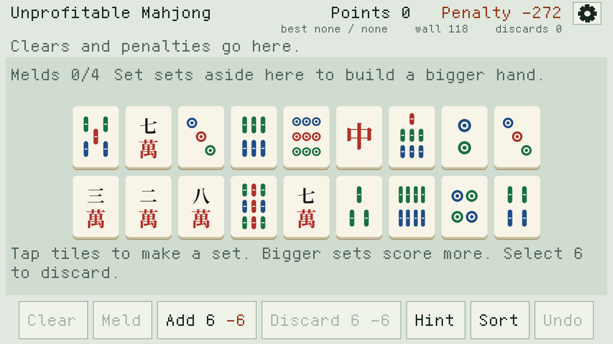
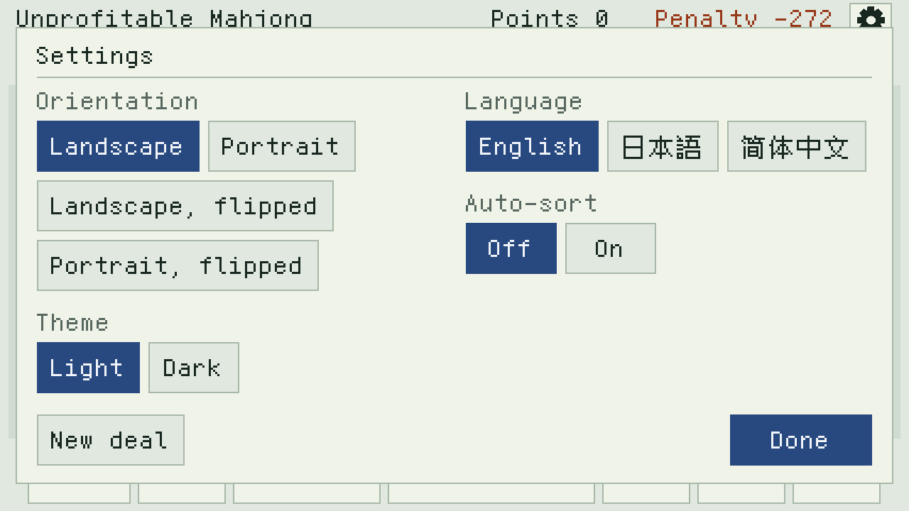
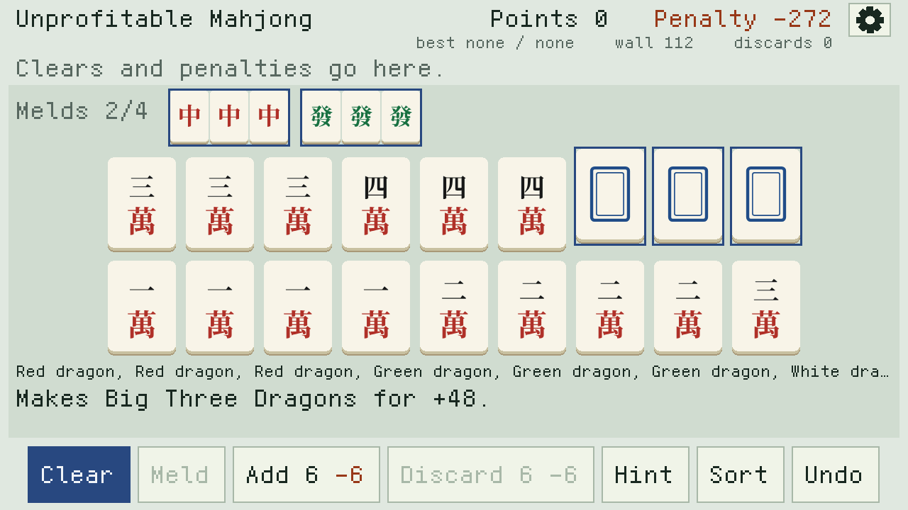
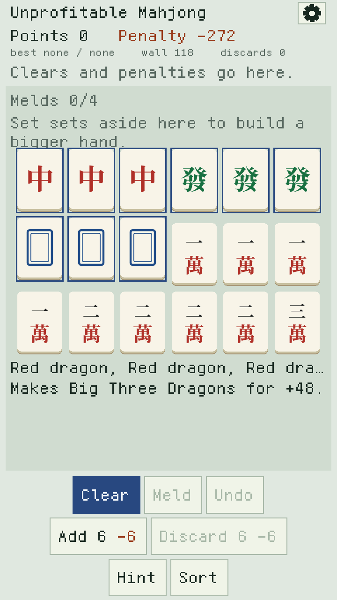
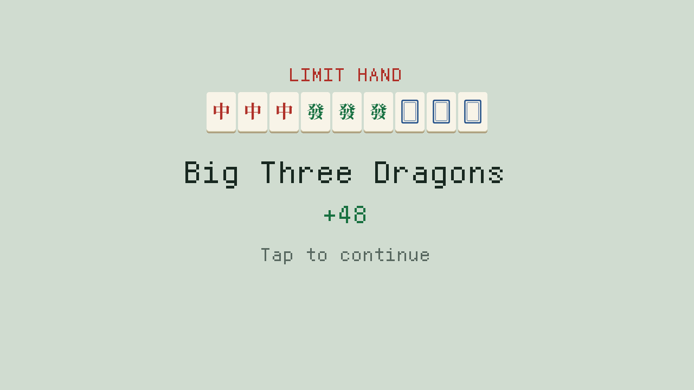
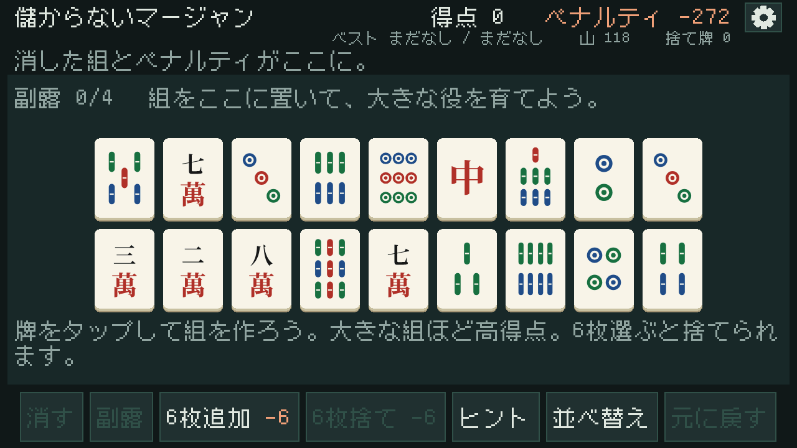
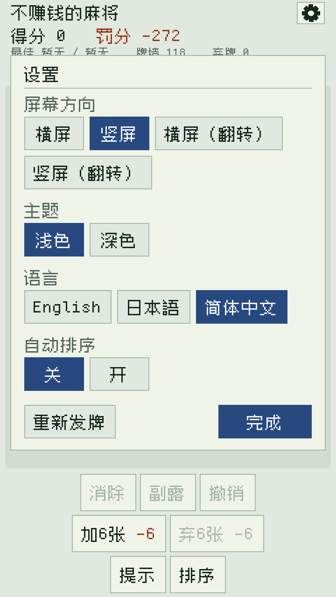

# Unprofitable Mahjong for the M5Stack Tab5

The same game as `../index.html`, as firmware for the M5Stack Tab5
(ESP32-P4, 5″ 1280×720 touch panel), in landscape or portrait.

**Status: built with ESP-IDF 6.1 and run on a board** (the panel, touch
and the four orientations). The settings panel -- theme and language --
has so far only been run on a PC through the graphics library's own host
shim (below). The rules are tested against the web version.

## Building

    cd m5tab5
    idf.py set-target esp32p4
    idf.py build flash monitor

ESP-IDF 5.4.2 or later. The libraries are fetched by the component
manager at the tags in `main/idf_component.yml`; the first build writes
`dependencies.lock`, which should be read before it is committed.

## Plan

| Part | What | Built on |
|---|---|---|
| `core/` | Rules: deal, sets and scores, melds, discards, penalty, hint. Plain C, no IDF. | -- |
| `test/` | Host tests that check `core/` against the web version's own code, run with Node. | gcc, Node |
| `tools/` | Renders the 34 tile faces from the web version's drawings into RGB565 arrays, committed like Ark12. | Python, Pillow |
| `main/` | Board bring-up, drawing, touch and saves. | `feckless_graphics_handler`, `feckless_drivers` |
| `test/screen/` | Runs `main/ui.c` on a PC with scripted taps and saves what it draws. | gcc, the graphics library's host shim |

Drawing goes through `gfx`: the shadow buffer is redrawn where something
changed and blitted a band at a time, so tapping a tile costs one row of
tiles, not a frame. Text is Ark12 at scale; it carries the CJK the
Japanese and Chinese screens need, except 雀 (see Languages).

Saves (the game in progress, best scores, settings) go in NVS after
every move, so pulling the power loses nothing. The SD card is not
needed for anything yet, so `feckless_storage_handler` is not a
dependency until something is.

## The screen

The gear, top right, opens the settings: the orientation (landscape,
portrait, or either one flipped), a light or dark theme, the language
-- English, 日本語 or 简体中文 -- and auto-sort. Each takes effect as it
is tapped and is saved; Done, or a tap outside the panel, closes it.
New deal is there too, and asks for a second tap. The picture
and the touch coordinates always turn together. The dark theme is the
web version's; the tiles keep their ivory faces in both.

The panel is about 294 pixels to the inch, so text is Ark12 at 36 px
(about 9 pt); 24 px is left for the line of bests and piles, the
rail's values, and the list of chosen tiles in landscape.

Landscape is 1280×720: the scores along the top, the rail of recent
clears, the meld row, the hand (two rows of 9, or 12 after Add 6), the
status and seven buttons in a row. Portrait is 720×1280: the hand six
across in three rows (four after Add 6), the status under it, and the
buttons in three rows at the bottom. Tap tiles to select them;
tap a meld to select all of it. Undo goes back up to 64 moves, and like
the web version it cannot reach past Add 6 or Discard 6.

Clearing a limit hand plays the celebration: the tiles land one at a
time, the name, and the points counting up.

## Languages

Every word on the screen is marked in the source the way
defeatist-music-player-for-m5tab5 does it, lv_i18n's shape without
LVGL: `_("Hint")` where it is drawn, `N_()` in a static table, the
English as the key. `tools/i18n.py` (that project's, cut to three
locales) extracts them into `i18n/<locale>.yml` and compiles those into
`main/i18n_tab.c`, which is committed so a build needs no Python:

    python3 m5tab5/tools/i18n.py extract
    python3 m5tab5/tools/i18n.py compile --ark12 path/to/fonts/ark12/ark12.c
    python3 m5tab5/tools/i18n.py check   --ark12 path/to/fonts/ark12/ark12.c

The translations are the web version's: riichi names in Japanese, MCR
names in Chinese. `--ark12` refuses a translation with a character the
font cannot draw, so the Japanese title is 儲からないマージャン (Ark12 has
no 雀), and a few lines are reworded around 覇, 脇, 奖 and 即.

## Seeing the screen without a board

`test/screen/` compiles `main/ui.c`, the tile drawing and the rules
exactly as they ship, with feckless-graphics-handler's real `gfx.c`
through that library's own host shim. Touch is replaced by a script of
taps, and the screen is saved before each one:

    make -C m5tab5/test/screen GFX=/path/to/feckless-graphics-handler-for-m5tab5
    cd m5tab5/test/screen && mkdir -p out
    ./screentest out/shot 660,660 310,290 640,435 75,660

`SCREENTEST_DEAL=dragons` starts from three dragon pungs, for the meld
row and the celebration, `SCREENTEST_ROT=0..3` picks the orientation
(landscape, 1, by default), `SCREENTEST_LANG` the language (0 English,
1 Chinese, 2 Japanese) and `SCREENTEST_THEME=1` the dark theme. The screenshots above came from
it.

## Testing the rules

`core/` is checked against the web version itself. `test/check.js` loads
the rules straight out of `../index.html` and compares them with the C
build, move by move:

    make -C m5tab5/test              # 2000 random games, about a minute
    make -C m5tab5/test GAMES=200    # a quick run

It compares about 57,000 tile groups (set and points) and every move of
the games: the table, melds, wall, discard pile, points, penalty, the
hint's choice and the stranded-honor warning. It needs a C compiler and
Node.js, and builds with AddressSanitizer and UBSan.

## Credits

Same as the web version: designed by Sudrien, written with Claude.
